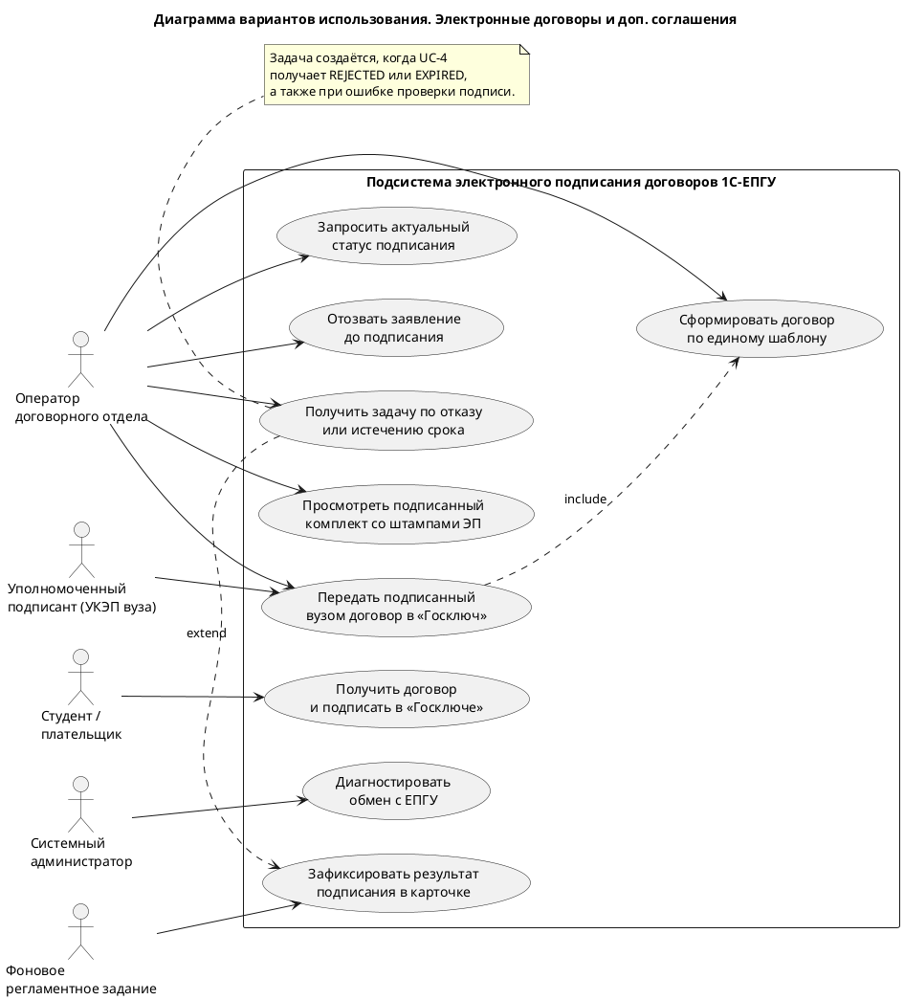
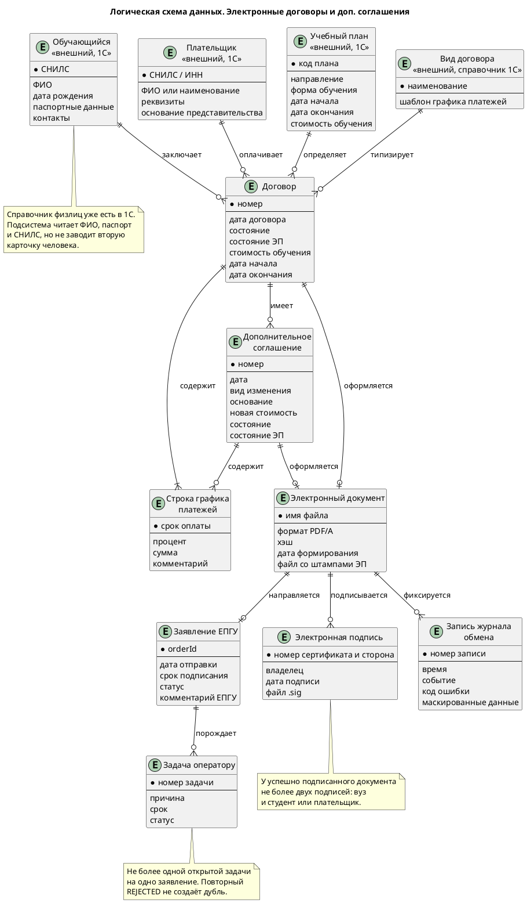

# Документ пользовательских требований

**Вариант:** 03-Электронные-договоры-и-допсоглашения  
**Команда:** Сапунков Артемий Романович, Блошкин Юрий Викторович (гр. ПрИн-366)  
**Связанный документ концепции:** [`case_concept.md`](case_concept.md) (лабораторная работа 1)  
**Дата:** 2026-11-20  
**Статус:** версия 1.0, прошла проверку по десяти шагам

Пользовательское требование в этой работе — эпик. Эпик описывает законченную цель актора, а не отдельное поле формы и не одну кнопку. У каждого эпика две записи об одном и том же требовании: пользовательская история и сценарий использования. История и сценарий проверены на согласованность: если история обещает одну ценность, сценарий заканчивается той же ценностью.

Все числовые метрики взяты из `case_concept.md` (разделы 2.3, 4, 5, 9) или из материалов ИТ-отдела в `src/1С-Университет-ПРОФ/`. Метрика, которой нет в концепции, помечена как допущение и связана с риском. Новых бизнес-целей в документ не добавлялось: используются только BO-1…BO-4 из концепции.

---

## 1. Реинжиниринг дерева функций

### 1.1. Исходное дерево функций

Исходное дерево взято из [`case_concept.md`](case_concept.md), раздел 4.2, без переписывания «как хотелось бы».

```mermaid
flowchart TB
  subgraph System["Подсистема электронного подписания 1С–ЕПГУ"]
    F1["1. Формирование документа"]
    F2["2. Подписание вузом"]
    F3["3. Интеграция с ЕПГУ"]
    F4["4. Фиксация результата"]
    F5["5. Администрирование и аудит"]
  end

  F1 --> F11["Генерация PDF/A из макета 1С"]
  F1 --> F12["Проверка обязательных реквизитов (СНИЛС, паспорт, сумма)"]
  F1 --> F13["Блокировка редактирования полей карточки"]

  F2 --> F21["Выбор криптопровайдера (КриптоПро CSP)"]
  F2 --> F22["Создание отсоединенной УКЭП вуза (.sig)"]
  F2 --> F23["Сохранение подписи в хранилище объекта 1С"]

  F3 --> F31["Формирование JSON-пакета запроса API ЕПГУ"]
  F3 --> F32["Отправка заявления (POST /v1/orders)"]
  F3 --> F33["Регламентный опрос статусов (GET /v1/orders/{orderId})"]
  F3 --> F34["Обработка ошибок транспорта и валидации API"]

  F4 --> F41["Загрузка подписи студента из Госключа"]
  F4 --> F42["Валидация целостности и цепочки сертификата"]
  F4 --> F43["Автоматический перевод договора в 'Утвержден'"]
  F4 --> F44["Формирование PDF со штампами визуализации ЭП"]

  F5 --> F51["Журналирование событий обмена (лог API)"]
  F5 --> F52["Оповещение оператора о сбоях и отказах"]
```



### 1.2. Сверка дерева с пользовательскими целями

| ID эпика | Пользовательское требование | Узел дерева функций | Есть в дереве | Что сделано |
|----------|-----------------------------|---------------------|---------------|-------------|
| EP-1 | Оператор формирует договор или доп. соглашение из карточки 1С по единому шаблону | 1. Формирование документа → F11 «Генерация PDF/A из макета 1С», F12 «Проверка обязательных реквизитов» | да | оставлен; F13 «Блокировка редактирования» отнесена к EP-2, потому что блокировка наступает после подписания и отправки, а не после предпросмотра |
| EP-2 | Оператор подписывает договор УКЭП вуза и отправляет студенту в «Госключ» | 2. Подписание вузом → F21–F23; 3. Интеграция с ЕПГУ → F31, F32, F34; F13 | да | оставлен; F33 «Регламентный опрос» вынесен в EP-4, потому что это отдельная автоматическая цель, а не шаг отправки |
| EP-3 | Студент или плательщик получает договор в «Госключе», знакомится и подписывает либо отказывается | 3. Интеграция с ЕПГУ → доставка и уведомление второй стороны | пробел | добавлен узел F35 «Доставка документа и уведомление второй стороны в Госключе»; без него цель студента в дереве не видна |
| EP-4 | Система автоматически забирает подпись студента и переводит договор в «Утвержден» | 4. Фиксация результата → F41–F43 | да | оставлен; сюда же отнесён F33 как источник статуса |
| EP-5 | Оператор просматривает и выгружает подписанный комплект со штампами ЭП | 4. Фиксация результата → F44 | да | оставлен |
| EP-6 | Оператор вручную запрашивает актуальный статус по договору | 3. Интеграция с ЕПГУ → ручной запрос статуса | пробел | добавлен узел F36 «Ручной запрос статуса по договору»; в исходном дереве был только регламентный опрос F33 |
| EP-7 | Оператор отзывает заявление до подписания студентом | 3. Интеграция с ЕПГУ → отзыв заявления | пробел | добавлен узел F37 «Отзыв (аннулирование) заявления»; функция FE-7 заявлена в концепции, но в дереве отсутствовала |
| EP-8 | Системный администратор диагностирует обмен и видит очередь ошибок | 5. Администрирование и аудит → F51, F52; просмотр очереди и повторная отправка | пробел | добавлен узел F53 «Просмотр очереди обмена и повторная отправка»; F51–F52 уже были |
| EP-9 | Оператор получает задачу по отказу студента или истечению срока | 4. Фиксация результата → обработка отказа и истечения срока; F52 | пробел | добавлен узел F45 «Обработка отказа студента и истечения срока»; F52 дополняет его оповещением |

### 1.3. Скорректированное дерево функций

```mermaid
flowchart TB
  subgraph System["Подсистема электронного подписания 1С–ЕПГУ"]
    F1["1. Формирование документа"]
    F2["2. Подписание вузом"]
    F3["3. Интеграция с ЕПГУ"]
    F4["4. Фиксация результата"]
    F5["5. Администрирование и аудит"]
  end

  F1 --> F11["Генерация PDF/A из макета 1С"]
  F1 --> F12["Проверка обязательных реквизитов (СНИЛС, паспорт, сумма)"]
  F1 --> F13["Блокировка редактирования полей карточки"]

  F2 --> F21["Выбор криптопровайдера (КриптоПро CSP)"]
  F2 --> F22["Создание отсоединенной УКЭП вуза (.sig)"]
  F2 --> F23["Сохранение подписи в хранилище объекта 1С"]

  F3 --> F31["Формирование JSON-пакета запроса API ЕПГУ"]
  F3 --> F32["Отправка заявления (POST /v1/orders)"]
  F3 --> F33["Регламентный опрос статусов (GET /v1/orders/{orderId})"]
  F3 --> F34["Обработка ошибок транспорта и валидации API"]
  F3 --> F35["Доставка документа и уведомление второй стороны в Госключе"]
  F3 --> F36["Ручной запрос статуса по договору"]
  F3 --> F37["Отзыв (аннулирование) заявления"]

  F4 --> F41["Загрузка подписи студента из Госключа"]
  F4 --> F42["Валидация целостности и цепочки сертификата"]
  F4 --> F43["Автоматический перевод договора в 'Утвержден'"]
  F4 --> F44["Формирование PDF со штампами визуализации ЭП"]
  F4 --> F45["Обработка отказа студента и истечения срока"]

  F5 --> F51["Журналирование событий обмена (лог API)"]
  F5 --> F52["Оповещение оператора о сбоях и отказах"]
  F5 --> F53["Просмотр очереди обмена и повторная отправка"]
```



### 1.4. Что не стало эпиком и почему

| Узел или цель | Почему не эпик |
|---------------|----------------|
| F13 «Блокировка редактирования полей карточки» | это бизнес-правило BR-2 и шаг сценария EP-2, а не отдельная цель актора |
| F21 «Выбор криптопровайдера» | техническая настройка администратора, не пользовательская цель договорного отдела |
| F42 «Валидация целостности и цепочки сертификата» | шаг EP-4; пользователь не принимает по нему отдельного решения |
| Трёхсторонние договоры с юридическими лицами через коммерческий ЭДО | вынесено за рамки выпуска 1.0, `case_concept.md`, раздел 6.2, п. 3; выпуск 2.0 |
| Онлайн-оплата первого транша при подписании | вынесено за рамки выпуска 1.0, `case_concept.md`, раздел 6.2, п. 4; выпуск 2.0 |
| Личный кабинет студента для подписи | вынесено за рамки, `case_concept.md`, раздел 6.2, п. 2; подпись остаётся в «Госключе» |
| Расчёт стоимости, учебные планы и графики платежей | существующий механизм 1С, не меняется; `case_concept.md`, раздел 6.2, п. 1 |
| Бумажное подписание как резервный канал | внешний резервный процесс, не функция подсистемы; упомянут в RSK-1 |

---

## 2. Диаграмма вариантов использования

Исходник: [`diagrams/usecase.puml`](diagrams/usecase.puml). В документ вставлен тот же код.



### 2.1. Граница системы

Граница названа по кейсу: **«Подсистема электронного подписания договоров 1С–ЕПГУ»**. Внутри границы — функции, которые выполняет расширение «1С:Университет ПРОФ»: формирование PDF/A, подписание УКЭП вуза, отправка заявления, опрос статусов, приём подписи, визуализация штампов, отзыв и журналирование. «Госключ» и ЕПГУ — внешние системы: студент подписывает документ там, а подсистема получает результат через API. Поэтому UC-3 показывает цель студента, но не внутренние экраны «Госключа».

### 2.2. Соответствие «узел дерева → вариант использования → актор»

| Узел дерева | Вариант использования | Актор |
|-------------|----------------------|-------|
| 1. Формирование документа → F11, F12 | UC-1 Сформировать договор по единому шаблону | Оператор договорного отдела |
| 2. Подписание вузом → F21–F23; 3. Интеграция → F31, F32, F34; F13 | UC-2 Передать подписанный вузом договор в «Госключ» | Оператор договорного отдела; уполномоченный подписант (владелец УКЭП) |
| 3. Интеграция с ЕПГУ → F35 | UC-3 Получить договор и подписать в «Госключе» | Студент / плательщик |
| 3. Интеграция → F33; 4. Фиксация → F41–F43 | UC-4 Зафиксировать результат подписания в карточке | Фоновое регламентное задание |
| 4. Фиксация результата → F44 | UC-5 Просмотреть подписанный комплект со штампами ЭП | Оператор договорного отдела |
| 3. Интеграция с ЕПГУ → F36 | UC-6 Запросить актуальный статус подписания | Оператор договорного отдела |
| 3. Интеграция с ЕПГУ → F37 | UC-7 Отозвать заявление до подписания | Оператор договорного отдела |
| 5. Администрирование и аудит → F51–F53 | UC-8 Диагностировать обмен с ЕПГУ | Системный администратор |
| 4. Фиксация → F45; 5. Администрирование → F52 | UC-9 Получить задачу по отказу или истечению срока | Оператор договорного отдела |

### 2.3. Почему на диаграмме именно такие связи

- **`include` UC-2 → UC-1.** В основном потоке UC-2 шаг 4 явно вызывает формирование PDF/A. Без PDF подписывать нечего. Это не «стрелка для красоты», а обязательное включение.
- **`extend` UC-9 → UC-4.** UC-4 в успешном исходе переводит договор в «Утвержден». Задача оператору появляется только в ветке `REJECTED` / `EXPIRED` или при ошибке проверки подписи, то есть это необязательное расширение базового сценария.
- **Нет `include` у UC-6 и UC-4.** Ручной и автоматический запрос статуса решают разные цели и запускаются по-разному. Общая у них только внутренняя операция `GET /v1/orders/{orderId}`, но она не является отдельным вариантом использования пользователя. Дублировать её стрелкой `include` значило бы рисовать связь, которой нет в сценарии.
- **Нет `extend` у UC-7 и UC-3.** Отзыв — не расширение подписания, а отдельная цель оператора с собственным триггером. Если студент уже подписал, отзыв недоступен; это исключение UC-7, а не расширение UC-3.
- **Акторы — роли из профилей заинтересованных лиц.** В `case_concept.md` раздел 3.1 перечислены договорной отдел, юридическая служба, уполномоченный подписант, студенты/плательщики и ИТ-служба. На диаграмме нет «пользователя» без роли. Фоновое задание — системный актор, потому что в концепции UC-9 прямо назван «регламентное фоновое задание 1С».

## 3. Эпики

Ниже — окончательные формулировки после проверки по шагам 5.2–5.10. Черновики, которые менялись, зафиксированы в протоколе дефектов раздела 5.10, а не затёрты.

### EP-1. Сформировать договор или дополнительное соглашение по единому шаблону

- Уровень: эпик
- Узел дерева: 1. Формирование документа → F11 «Генерация PDF/A из макета 1С», F12 «Проверка обязательных реквизитов»
- Бизнес-цель из документа концепции: BO-2 (устранение ручной сборки и повторного ввода), BO-4 (исключение расхождений в текстах); критерий AC-1
- Источник (стейкхолдер): оператор договорного отдела / учебного управления
- Приоритет MoSCoW: Must have

**Пользовательская история.** Как оператор договорного отдела, я хочу сформировать договор или дополнительное соглашение из карточки 1С по единому утверждённому макету, чтобы не собирать текст в Word и исключить расхождения в реквизитах, суммах и условиях.

**Сценарий использования UC-1.**

| Поле | Содержание |
|------|------------|
| Акторы | Оператор договорного отдела; «1С:Университет ПРОФ» |
| Предусловия | Карточка договора или доп. соглашения существует и находится в состоянии `Проект`. Заполнены обучающийся, плательщик, учебный план, стоимость обучения и график платежей. В карточке физлица заполнены СНИЛС и паспортные данные. |
| Триггер | Оператор нажимает «Сформировать документ» в карточке. При отправке из UC-2 этот сценарий включается автоматически. |
| Постусловия успеха | Сформирован PDF/A по действующему макету. Файл сохранён в `ФайлПечатнойФормы`. Для договора и доп. соглашения использован соответствующий макет. Оператор видит готовый документ. |
| Постусловия отказа | PDF не создан, `ФайлПечатнойФормы` не изменён, состояние договора не меняется. Оператор видит диагностическое сообщение с перечнем незаполненных или некорректных реквизитов. |

Основной поток:

1. Оператор открывает карточку договора или доп. соглашения в состоянии `Проект`.
2. Оператор нажимает «Сформировать документ».
3. Система проверяет обязательные реквизиты: обучающийся, плательщик, учебный план, стоимость обучения, строки графика платежей, СНИЛС и паспортные данные.
4. Система выбирает макет: для договора — макет договора, для доп. соглашения — макет доп. соглашения с реквизитами основного договора.
5. Система собирает PDF/A из данных 1С. Текст не редактируется вручную.
6. Система сохраняет файл в `ФайлПечатнойФормы` и показывает его оператору.

Альтернативы:

1. Плательщиком выступает третье лицо. В документ выводятся реквизиты плательщика и основание представительства; дальнейшие шаги выполняются штатно.
2. Формируется дополнительное соглашение. Используется макет доп. соглашения и данные основного договора; отдельный договор не создаётся.

Исключения:

1. СНИЛС отсутствует или не проходит проверку контрольной суммы. Формирование прерывается, PDF не создаётся, оператор видит сообщение «Не указан корректный СНИЛС».
2. Не заполнен график платежей или стоимость обучения. Формирование прерывается, оператор видит перечень пустых полей.
3. Ошибка формирования PDF/A. Событие пишется в журнал, файл не сохраняется, оператор видит сообщение об ошибке.

---

### EP-2. Подписать договор вузом и отправить студенту в «Госключ»

- Уровень: эпик
- Узел дерева: 2. Подписание вузом → F21–F23; 3. Интеграция с ЕПГУ → F31, F32, F34; F13 «Блокировка редактирования полей карточки»
- Бизнес-цель из документа концепции: BO-1 (сокращение срока подписания), BO-2 (устранение перемещения бумаг), BO-3 (доля договоров через «Госключ»); критерии AC-2, AC-6
- Источник (стейкхолдер): оператор договорного отдела; уполномоченный подписант — владелец УКЭП вуза
- Приоритет MoSCoW: Must have

**Пользовательская история.** Как оператор договорного отдела, я хочу одной командой подписать договор УКЭП университета и отправить его студенту в «Госключ», чтобы убрать печать, обход кабинетов и ручную передачу бумаги.

**Сценарий использования UC-2.**

| Поле | Содержание |
|------|------------|
| Акторы | Оператор договорного отдела; уполномоченный подписант (владелец УКЭП); «1С:Университет ПРОФ»; «КриптоПро CSP»; ЕПГУ / «Госключ» |
| Предусловия | Договор находится в состоянии `Проект`. UC-1 выполнен успешно. Заполнен корректный СНИЛС получателя. Действует сертификат УКЭП вуза. Активна учётная запись шлюза ЕПГУ. |
| Триггер | Оператор нажимает «Подписать и отправить студенту» в карточке договора или доп. соглашения. |
| Постусловия успеха | `СостояниеЭП = ОтправленСтуденту`. Заполнены `ДатаПодписиУниверситета`, `ДатаОтправкиНаЕПГУ`, `ИдентификаторЗаявленияЕПГУ`. В `ФайлПечатнойФормы` и `ПодписьУниверситета` сохранены PDF/A и отсоединённая подпись `.sig`. Редактирование карточки заблокировано. У студента или плательщика появилось входящее уведомление в «Госключе». |
| Постусловия отказа | Договор не отправлен. Если подпись вуза уже сформирована, PDF и `.sig` сохранены, но карточка остаётся заблокированной для защиты подписанного текста; доступна повторная отправка. Если подпись не сформирована, состояние и файлы не меняются. |

Основной поток:

1. Оператор открывает карточку договора в состоянии `Проект`.
2. Оператор нажимает «Подписать и отправить студенту».
3. Система проверяет готовность: состояние `Проект`, заполненность обязательных реквизитов, контрольную сумму СНИЛС, срок действия сертификата УКЭП и доступность шлюза ЕПГУ.
4. Система выполняет UC-1 и получает PDF/A.
5. Система вызывает «КриптоПро CSP» и формирует отсоединённую подпись PKCS#7 (`.sig`) закрытым ключом университета.
6. Система сохраняет PDF/A и `.sig` в `ФайлПечатнойФормы` и `ПодписьУниверситета`.
7. Система определяет получателя: СНИЛС обучающегося, а если `ИсточникФинансирования` не совпадает с обучающимся — СНИЛС плательщика.
8. Система формирует `req.xml` и архив с PDF и `.sig`.
9. Система вызывает `POST /v1/orders` и получает `orderId`.
10. Система записывает `orderId`, даты подписи и отправки, устанавливает `СостояниеЭП = ОтправленСтуденту` и блокирует редактирование карточки.
11. Оператор видит сообщение об успешной отправке; студент получает уведомление в «Госключе».

Альтернативы:

1. Плательщиком выступает третье лицо. Получателем в «Госключе» становится плательщик; его СНИЛС подставляется на шаге 7. Дальнейшие шаги штатные.
2. Повторная отправка после транспортной ошибки. Система использует уже сформированный PDF и `.sig`, повторяет `POST /v1/orders` и обновляет `orderId`. Перед повтором проверяется, не было ли заявление уже зарегистрировано, чтобы не создать дубль.

Исключения:

1. Некорректный или отсутствующий СНИЛС. Система останавливается до подписи, состояние не меняется, оператор видит диагностику (AC-6).
2. Сертификат УКЭП отозван или просрочен. Система останавливается, пишет ошибку в журнал, оператор видит сообщение «Ошибка формирования УКЭП университета».
3. ЕПГУ недоступен, возвращает 5xx или не отвечает за 5 секунд. PDF и `.sig` сохранены, `СостояниеЭП = ОшибкаОтправкиЕПГУ`, в `КомментарийЕПГУ` записан текст ошибки, доступна кнопка «Повторить отправку».
4. ЕПГУ отклонил запрос по формату или составу пакета (4xx). Отправка не выполнена, ошибка записана в журнал, оператору создаётся задача на разбор. Если причина в данных, исправление требует возврата договора в работу по регламенту администратора; автоматически подписанный текст не редактируется.
5. Архив превышает ограничения канала (15 файлов или 100 МБ). Отправка останавливается, оператор видит сообщение с превышенным лимитом.

---

### EP-3. Получить договор и подписать его в «Госключе»

- Уровень: эпик
- Узел дерева: 3. Интеграция с ЕПГУ → F35 «Доставка документа и уведомление второй стороны в Госключе»
- Бизнес-цель из документа концепции: BO-1 (сокращение срока), BO-3 (доля договоров через «Госключ»); критерий AC-3
- Источник (стейкхолдер): студент или плательщик — законный представитель
- Приоритет MoSCoW: Must have

**Пользовательская история.** Как студент или плательщик — законный представитель, я хочу получить договор в «Госключе», ознакомиться с ним и подписать либо отказаться с указанием причины, чтобы заключить договор без визита в университет и без обмена бумагой.

**Сценарий использования UC-3.**

| Поле | Содержание |
|------|------------|
| Акторы | Студент / плательщик; ЕПГУ / «Госключ»; «1С:Университет ПРОФ» — отправитель |
| Предусловия | UC-2 выполнен успешно. У получателя есть подтверждённая учётная запись ЕСИА и установленное приложение «Госключ». Заявление активно, срок подписания не истёк. |
| Триггер | ЕПГУ доставляет получателю push-уведомление о документе на подписание. |
| Постусловия успеха | Получатель ознакомился с PDF и подписал документ УНЭП или УКЭП. ЕПГУ зафиксировал статус `SIGNED` и сохранил отсоединённую подпись. Документ готов к загрузке в 1С по UC-4. |
| Постусловия отказа | Получатель отказался: ЕПГУ зафиксировал `REJECTED` и причину. Получатель не подписал за 24 часа: ЕПГУ зафиксировал `EXPIRED`. В обоих случаях подпись студента отсутствует, договор не считается заключённым. |

Основной поток:

1. ЕПГУ доставляет уведомление в приложение «Госключ».
2. Получатель открывает уведомление и карточку документа: отправитель, сумма, срок действия предложения.
3. Получатель открывает PDF и знакомится с текстом. Редактирование текста невозможно.
4. Получатель подтверждает ознакомление и подписывает документ своей УНЭП или УКЭП.
5. ЕПГУ фиксирует `SIGNED` и сохраняет файл подписи.
6. Получатель видит подтверждение; результат становится доступен подсистеме 1С для обработки по UC-4.

Альтернативы:

1. Получатель отказывается. Он выбирает «Отказаться», указывает причину (необязательно) и подтверждает отказ. ЕПГУ возвращает `REJECTED`; UC-4 переводит договор в `ОтклоненСтудентом` и создаёт задачу по UC-9.
2. Получатель не предпринимает действий. По истечении срока подписания ЕПГУ возвращает `EXPIRED`; UC-4 переводит договор в `ИстекСрокПодписания` и создаёт задачу по UC-9.

Исключения:

1. У получателя нет подтверждённой учётной записи ЕСИА или приложения «Госключ». ЕПГУ фиксирует ошибку доставки; подсистема записывает ошибку в журнал и показывает оператору, что автоматический канал недоступен. Резервный бумажный сценарий остаётся внешним процессом (RSK-1).
2. Сертификат получателя отозван или недействителен. ЕПГУ не принимает подпись; статус не становится `SIGNED`, оператор получает задачу на разбор.
3. Получатель не получил уведомление. Оператор может связаться с ним и при необходимости повторить отправку. Срок действия заявления при этом не продлевается автоматически.

> **Сроки.** Технический срок подписания в «Госключе» — не более 24 часов с отправки: это ограничение канала ЕПГУ (`SignExpiration`) из материалов ИТ-отдела. 14 календарных дней из RSK-5 трактуются как внутренний срок работы оператора с задачей после истечения 24 часов, а не как срок жизни заявления в ЕПГУ. Расхождение зафиксировано как дефект DEF-2 в разделе 5.10.

---

### EP-4. Автоматически зафиксировать результат подписания в карточке

- Уровень: эпик
- Узел дерева: 3. Интеграция с ЕПГУ → F33; 4. Фиксация результата → F41–F43
- Бизнес-цель из документа концепции: BO-1 (сокращение срока), BO-3 (доля договоров через «Госключ»); критерий AC-4
- Источник (стейкхолдер): оператор договорного отдела — получатель ценности; фоновое регламентное задание — исполнитель
- Приоритет MoSCoW: Must have

**Пользовательская история.** Как оператор договорного отдела, я хочу, чтобы подпись студента автоматически возвращалась в карточку договора и договор переходил в «Утвержден», чтобы не скачивать и не прикреплять файлы вручную и не держать договор в подвешенном состоянии.

**Сценарий использования UC-4.**

| Поле | Содержание |
|------|------------|
| Акторы | Фоновое регламентное задание 1С; ЕПГУ / «Госключ»; оператор — получатель результата |
| Предусловия | `СостояниеЭП = ОтправленСтуденту`. Заполнен `ИдентификаторЗаявленияЕПГУ`. Заявление активно или завершено на стороне ЕПГУ. |
| Триггер | Очередной запуск регламентного задания (каждые 15 минут) или ручной запрос статуса по UC-6. |
| Постусловия успеха | Получен статус `SIGNED`. Подпись студента скачана и проверена. Заполнены `ПодписьСтудента` и `ДатаПодписиСтудента`. `СостояниеЭП = ПодписанСторонами`, `Состояние = Утвержден`. Событие записано в журнал. |
| Постусловия отказа | При `REJECTED` — `СостояниеЭП = ОтклоненСтудентом`, договор остаётся в `Проект`, редактирование разблокировано, создаётся задача по UC-9. При `EXPIRED` — `СостояниеЭП = ИстекСрокПодписания`, те же действия. При технической ошибке состояние не меняется, выполняется повтор в следующем запуске. |

Основной поток:

1. Регламентное задание выбирает договоры и доп. соглашения в состоянии `ОтправленСтуденту`.
2. Для каждого объекта система вызывает `GET /v1/orders/{orderId}`.
3. Система получает статус `SIGNED` и файл отсоединённой подписи студента.
4. Система проверяет целостность файла и цепочку сертификата.
5. Система сохраняет подпись в `ПодписьСтудента`, фиксирует `ДатаПодписиСтудента`.
6. Система устанавливает `СостояниеЭП = ПодписанСторонами` и переводит договор в `Состояние = Утвержден`.
7. Система пишет в журнал обмена запись об успешной фиксации.

Альтернативы:

1. Статус `REJECTED`. Система фиксирует `ОтклоненСтудентом`, причину из ответа ЕПГУ и создаёт задачу по UC-9. Редактирование разблокируется, чтобы оператор мог исправить договор и отправить заново.
2. Статус `EXPIRED`. Система фиксирует `ИстекСрокПодписания`, создаёт задачу по UC-9 и разблокирует редактирование.
3. Статус `PENDING` или `VIEWED`. Состояние не меняется, событие пишется в журнал, опрос повторяется в следующем запуске.
4. Подпись уже была сохранена ранее. Повторный `SIGNED` не создаёт дубль: система проверяет `ПодписьСтудента` и дату, запись не перезаписывается.

Исключения:

1. ЕПГУ недоступен или отвечает 5xx. Состояние не меняется, ошибка пишется в журнал, повтор — в следующем запуске по NFR-R1.
2. Подпись не прошла проверку целостности или цепочки сертификата. Договор не переводится в `Утвержден`, в `КомментарийЕПГУ` пишется причина, создаётся задача администратору. Отдельного значения перечисления для этого случая в концепции нет — дефект DEF-3.
3. Заявление не найдено (404). Состояние не меняется, создаётся задача администратору, событие пишется в журнал.
4. Задание не смогло записать результат в объект. Транзакция откатывается, событие пишется в журнал, повтор в следующем запуске; договор не остаётся в ложном состоянии `Утвержден`.

---

### EP-5. Просмотреть и выгрузить подписанный комплект со штампами ЭП

- Уровень: эпик
- Узел дерева: 4. Фиксация результата → F44 «Формирование PDF со штампами визуализации ЭП»
- Бизнес-цель из документа концепции: BO-2 (отказ от сканирования и бумажного архива); критерий AC-4
- Источник (стейкхолдер): оператор договорного отдела; юридическая служба — получатель доказательной базы
- Приоритет MoSCoW: Should have

**Пользовательская история.** Как оператор договорного отдела, я хочу открыть подписанный договор с визуализированными штампами обеих подписей и выгрузить комплект PDF + `.sig`, чтобы передать его в архив или бухгалтерию и подтвердить юридическую силу документа.

**Сценарий использования UC-5.**

| Поле | Содержание |
|------|------------|
| Акторы | Оператор договорного отдела; «1С:Университет ПРОФ» |
| Предусловия | Договор находится в `Состояние = Утвержден`. В карточке есть `ФайлПечатнойФормы`, `ПодписьУниверситета` и `ПодписьСтудента`. |
| Триггер | Оператор нажимает «Просмотреть подписанный комплект» в карточке. |
| Постусловия успеха | Оператор видит PDF со штампами обеих подписей. Доступна выгрузка архива `PDF + .sig`. Факт просмотра или выгрузки записан в журнал доступа. |
| Постусловия отказа | Визуализированная копия не построена. Исходные PDF и `.sig` не изменены и остаются в карточке. Оператор видит сообщение об ошибке. |

Основной поток:

1. Оператор открывает договор в состоянии `Утвержден`.
2. Оператор нажимает «Просмотреть подписанный комплект».
3. Система проверяет наличие PDF и обеих подписей.
4. Система строит отображаемую копию PDF и накладывает штампы: номер сертификата, владелец, сторона подписи, период действия.
5. Система показывает PDF оператору.
6. Оператор выгружает архив `PDF + .sig` или отправляет документ на печать.
7. Система фиксирует в журнале доступа, кто и когда открыл или выгрузил комплект.

Альтернативы:

1. Оператору нужен исходный PDF без штампов для машинной обработки. Система разрешает выгрузить исходный файл отдельно, не подменяя его визуализированной копией.
2. Оператор печатает визуализированную копию. Печать не создаёт новую сущность и не меняет юридически значимые файлы.

Исключения:

1. В карточке есть только одна подпись. Система показывает частичный комплект, но блокирует выгрузку как «подписанного обеими сторонами» и сообщает, какой подписи не хватает.
2. Ошибка построения штампов. Система показывает исходный PDF, пишет ошибку в журнал, исходные файлы не изменяет.
3. У оператора нет прав на просмотр. Система отказывает в доступе и фиксирует попытку в журнале.

---

### EP-6. Запросить актуальный статус подписания вручную

- Уровень: эпик
- Узел дерева: 3. Интеграция с ЕПГУ → F36 «Ручной запрос статуса по договору»
- Бизнес-цель из документа концепции: BO-1 (сокращение срока), BO-3 (доля договоров через «Госключ»)
- Источник (стейкхолдер): оператор договорного отдела
- Приоритет MoSCoW: Should have

**Пользовательская история.** Как оператор договорного отдела, я хочу запросить актуальный статус подписания по конкретному договору, чтобы ответить студенту или руководителю, не дожидаясь очередного фонового опроса.

**Сценарий использования UC-6.**

| Поле | Содержание |
|------|------------|
| Акторы | Оператор договорного отдела; ЕПГУ / «Госключ» |
| Предусловия | В карточке заполнен `ИдентификаторЗаявленияЕПГУ`. Договор находится в состоянии `ОтправленСтуденту` или в состоянии технической ошибки отправки. |
| Триггер | Оператор нажимает «Обновить статус». |
| Постусловия успеха | Получен актуальный статус из ЕПГУ. `СостояниеЭП` и `КомментарийЕПГУ` обновлены, событие записано в журнал. Оператор видит статус и дату последней проверки. |
| Постусловия отказа | Статус не изменён. Оператор видит предупреждение, что ЕПГУ недоступен, и последний известный статус с датой. |

Основной поток:

1. Оператор открывает карточку договора.
2. Оператор нажимает «Обновить статус».
3. Система вызывает `GET /v1/orders/{orderId}`.
4. Система сопоставляет ответ ЕПГУ с `СостояниеЭП` и обновляет реквизиты.
5. Система пишет событие в журнал и показывает оператору статус, дату и комментарий.

Альтернативы:

1. Получен `SIGNED`. Результат передаётся в обработку UC-4: подпись скачивается, проверяется и сохраняется, договор переходит в `Утвержден`.
2. Получен `REJECTED` или `EXPIRED`. Результат передаётся в UC-4 и UC-9: статус фиксируется, создаётся задача, редактирование разблокируется.
3. Получен `PENDING` или `VIEWED`. Оператор видит, что документ ещё не подписан; состояние не меняется.

Исключения:

1. ЕПГУ не отвечает за 5 секунд. Оператор видит предупреждение, последний известный статус сохраняется, повтор возможен кнопкой или регламентным заданием.
2. Заявление не найдено (404). Оператор видит сообщение «Заявление не найдено», создаётся задача администратору.
3. Ответ ЕПГУ содержит неизвестный статус. Система не подменяет состояние догадкой, пишет ошибку в журнал и создаёт задачу администратору.

---

### EP-7. Отозвать заявление до подписания студентом

- Уровень: эпик
- Узел дерева: 3. Интеграция с ЕПГУ → F37 «Отзыв (аннулирование) заявления»
- Бизнес-цель из документа концепции: BO-1 (не ждать истечения срока при ошибке), BO-4 (исключение юридических коллизий); FE-7 концепции
- Источник (стейкхолдер): оператор договорного отдела
- Приоритет MoSCoW: Should have

**Пользовательская история.** Как оператор договорного отдела, я хочу отозвать отправленное заявление, пока студент его не подписал, чтобы исправить ошибку в договоре или отменить отправку, не дожидаясь истечения срока.

**Сценарий использования UC-7.**

| Поле | Содержание |
|------|------------|
| Акторы | Оператор договорного отдела; ЕПГУ / «Госключ» |
| Предусловия | `СостояниеЭП = ОтправленСтуденту`. Заявление ещё не подписано и не отклонено на стороне ЕПГУ. Заполнен `ИдентификаторЗаявленияЕПГУ`. |
| Триггер | Оператор нажимает «Отозвать заявление». |
| Постусловия успеха | ЕПГУ подтвердил аннулирование. `СостояниеЭП = Аннулирован`, `Состояние = Аннулирован`. Редактирование разблокировано, событие записано в журнал, оператор видит подтверждение. |
| Постусловия отказа | Аннулирование не подтверждено. `СостояниеЭП` и `Состояние` не меняются. Оператор видит причину, повтор возможен. |

Основной поток:

1. Оператор открывает договор в состоянии `ОтправленСтуденту`.
2. Оператор нажимает «Отозвать заявление».
3. Система проверяет, что студент ещё не подписал и не отказался.
4. Система вызывает API аннулирования ЕПГУ.
5. ЕПГУ подтверждает аннулирование.
6. Система устанавливает `СостояниеЭП = Аннулирован` и `Состояние = Аннулирован`, фиксирует дату и причину отзыва.
7. Система разблокирует редактирование и пишет событие в журнал.

Альтернативы:

1. Студент уже подписал. Кнопка отзыва недоступна, система показывает сообщение «Документ уже подписан студентом». Оператор переходит к UC-4 или UC-5.
2. Срок заявления уже истёк. Система фиксирует `ИстекСрокПодписания`, создаёт задачу по UC-9; отдельный отзыв не требуется.
3. Оператор указывает причину отзыва. Причина сохраняется в `КомментарийЕПГУ` и в журнале.

Исключения:

1. ЕПГУ недоступен. Аннулирование не выполнено, состояние не меняется, оператор видит предупреждение и может повторить.
2. ЕПГУ отвечает, что аннулирование невозможно. Система показывает причину, создаёт задачу администратору, состояние не подменяется.
3. Заявление не найдено. Система сообщает об этом и предлагает проверить `orderId`; создаётся задача администратору.

---

### EP-8. Диагностировать обмен с ЕПГУ и очередь ошибок

- Уровень: эпик
- Узел дерева: 5. Администрирование и аудит → F51 «Журналирование событий обмена», F52 «Оповещение оператора о сбоях и отказах», F53 «Просмотр очереди обмена и повторная отправка»
- Бизнес-цель из документа концепции: BO-1 и BO-3 (бесперебойный обмен в приёмную кампанию); NFR-A1, RSK-2
- Источник (стейкхолдер): системный администратор / ИТ-служба университета
- Приоритет MoSCoW: Should have

**Пользовательская история.** Как системный администратор, я хочу видеть очередь исходящих пакетов, коды ошибок и время последнего успешного опроса, чтобы быстро восстановить обмен и не потерять договоры в пик приёмной кампании.

**Сценарий использования UC-8.**

| Поле | Содержание |
|------|------------|
| Акторы | Системный администратор; «1С:Университет ПРОФ»; ЕПГУ / «Госключ» |
| Предусловия | Администратор имеет роль для просмотра журнала обмена. Журналирование API включено. |
| Триггер | Администратор открывает «Журнал обмена» или получает оповещение о сбое. |
| Постусловия успеха | Администратор видит очередь, коды ошибок и время последнего успешного опроса. При необходимости повторяет отправку или выгружает журнал. Персональные данные в журнале замаскированы. |
| Постусловия отказа | Журнал недоступен. Администратор видит сообщение об ошибке; данные договоров не меняются. |

Основной поток:

1. Администратор открывает журнал обмена.
2. Система показывает очередь исходящих пакетов, статусы, коды ошибок и время последнего успешного опроса.
3. Администратор фильтрует записи по договору, `orderId` или дате.
4. Администратор выбирает пакет с ошибкой и нажимает «Повторить отправку».
5. Система проверяет, не был ли пакет уже зарегистрирован, и повторяет отправку без создания дубля.
6. Администратор выгружает журнал или настраивает расписание опроса в пределах регламента.

Альтернативы:

1. Ошибок нет. Система показывает состояние «обмен в норме» и время последнего успешного опроса.
2. Повторная ошибка. Система создаёт инцидент и оповещает администратора; пакет остаётся в очереди.
3. Нет прав на изменение расписания. Администратор видит журнал, но кнопка настройки недоступна.

Исключения:

1. Хранилище журнала недоступно. Система показывает ошибку и не подменяет отсутствующие записи.
2. Повторная отправка уже зарегистрированного пакета. Система предупреждает и не создаёт второй `orderId`.
3. В журнале обнаружены персональные данные без маскировки. Запись не показывается, инцидент фиксируется; это нарушение NFR-S2.

---

### EP-9. Получить задачу по отказу студента или истечению срока

- Уровень: эпик
- Узел дерева: 4. Фиксация результата → F45 «Обработка отказа студента и истечения срока»; 5. Администрирование → F52 «Оповещение оператора о сбоях и отказах»
- Бизнес-цель из документа концепции: BO-3 (доля договоров через «Госключ»), RSK-5 (пассивное затягивание)
- Источник (стейкхолдер): оператор договорного отдела
- Приоритет MoSCoW: Must have

**Пользовательская история.** Как оператор договорного отдела, я хочу получать задачу с причиной отказа или истечения срока, чтобы связаться со студентом и закрыть договор по регламенту, а не искать зависшие договоры вручную.

**Сценарий использования UC-9.**

| Поле | Содержание |
|------|------------|
| Акторы | Оператор договорного отдела; «1С:Университет ПРОФ» |
| Предусловия | UC-4 или UC-6 получил `REJECTED`, `EXPIRED` или ошибку проверки подписи. В карточке есть договор и `orderId`. |
| Триггер | Переход статуса заявления в `REJECTED` или `EXPIRED` либо фиксация ошибки проверки подписи. |
| Постусловия успеха | Создана одна задача оператору с номером, договором, причиной и сроком. Договор находится в `ОтклоненСтудентом` или `ИстекСрокПодписания`. Редактирование разблокировано. Оператор видит задачу и может её закрыть после контакта со студентом. |
| Постусловия отказа | Задача не создана. Ошибка записана в журнал, оператору показано оповещение; статус договора всё равно виден в карточке, «тихой потери» нет. |

Основной поток:

1. Система получает `REJECTED` или `EXPIRED`.
2. Система устанавливает `СостояниеЭП = ОтклоненСтудентом` или `ИстекСрокПодписания` и разблокирует редактирование.
3. Система создаёт задачу оператору: номер, договор, причина, дата, срок внутренней работы 14 календарных дней.
4. Оператор открывает задачу и связывается со студентом или плательщиком.
5. Оператор фиксирует результат контакта и закрывает задачу. Договор остаётся в соответствующем состоянии либо отправляется заново после исправления.

Альтернативы:

1. Студент отказался без причины. Задача создаётся с пометкой «причина не указана».
2. Оператор решает отправить договор заново. Старая задача закрывается со ссылкой на новое заявление; создаётся новый `orderId`.
3. По заявлению уже есть открытая задача. Система не создаёт вторую, а обновляет существующую.

Исключения:

1. Не удалось создать задачу. Событие пишется в журнал, оператор видит оповещение; повтор создания выполняется при следующем запуске.
2. Задача уже закрыта, а по заявлению снова пришёл `REJECTED`. Система не открывает дубль без нового `orderId`; событие пишется в журнал.
3. Причина отказа содержит недопустимые символы или слишком длинная. Причина обрезается до допустимой длины, исходный ответ ЕПГУ остаётся в журнале.

---

## 4. Анализ сущностей и логическая схема данных

Сущности собраны из сценариев EP-1…EP-9, а не из будущих таблиц. На схеме только то, что пользователь различает: что он выбирает, что система хранит, что читает из существующего учёта 1С и что остаётся внешним. Исходник: [`diagrams/logical-data.puml`](diagrams/logical-data.puml).



### 4.1. Сущности

| Сущность | Эпик или сценарий | Что хранит система | Ключ, как его понимает пользователь |
|----------|-------------------|--------------------|-------------------------------------|
| Обучающийся | EP-1, EP-2, EP-3, EP-4; читается из 1С | ничего, только читает существующий справочник физлиц | СНИЛС |
| Плательщик | EP-2 ALT-1, EP-3; читается из 1С | ничего, только читает существующий справочник или контрагента | СНИЛС / ИНН |
| Учебный план | EP-1, EP-2; читается из 1С | ничего, только читает существующий справочник учебных планов | код плана |
| Вид договора | EP-1, EP-2; читается из справочника 1С | ничего, только читает существующий справочник | наименование вида |
| Договор | EP-1…EP-9 | сам объект договора, его состояние и реквизиты ЭП | номер договора |
| Дополнительное соглашение | EP-1, EP-2, EP-4, EP-5, EP-7 | сам объект доп. соглашения и ссылку на основной договор | номер доп. соглашения |
| Строка графика платежей | EP-1, EP-2, EP-5 | срок, процент, сумму и комментарий строки | срок оплаты |
| Электронный документ | EP-1, EP-2, EP-5 | PDF/A, хэш и визуализированную копию со штампами | имя файла, которое видно в карточке |
| Заявление ЕПГУ | EP-2, EP-4, EP-6, EP-7, EP-9 | `orderId`, дату отправки, срок подписания, статус и комментарий ЕПГУ | `orderId` |
| Электронная подпись | EP-2, EP-3, EP-4, EP-5 | файл `.sig`, владельца, сторону и дату подписи | номер сертификата и сторона |
| Запись журнала обмена | EP-2, EP-4, EP-6, EP-7, EP-8 | время, событие, код ошибки и маскированные данные | номер записи |
| Задача оператору | EP-9 | причину, срок и статус задачи | номер задачи |

### 4.2. Связи и кратность

| Связь | Кратность | Откуда это видно в постусловии |
|-------|-----------|--------------------------------|
| Обучающийся — Договор | 1 : 0..* | Постусловие EP-1 требует ровно одного обучающегося в договоре; один студент может иметь несколько договоров за время обучения |
| Плательщик — Договор | 1 : 0..* | EP-2 ALT-1: у договора ровно один источник финансирования; один плательщик может оплачивать несколько договоров |
| Учебный план — Договор | 1 : 0..* | EP-1: `УчебныйПлан` обязателен; один план используется многими договорами |
| Вид договора — Договор | 1 : 0..* | EP-1: `ВидДоговора` обязателен; вид типизирует много договоров |
| Договор — Дополнительное соглашение | 1 : 0..* | EP-1: доп. соглашение создаётся из основного договора; у договора может быть несколько соглашений |
| Договор — Строка графика платежей | 1 : 1..* | EP-1: перед формированием график должен быть заполнен; у договора есть хотя бы одна строка |
| Дополнительное соглашение — Строка графика платежей | 1 : 0..* | EP-1: строки появляются, только если доп. соглашение меняет оплату |
| Договор — Электронный документ | 1 : 0..1 | EP-1: у договора один PDF на выпуск; до формирования файла связи нет |
| Дополнительное соглашение — Электронный документ | 1 : 0..1 | EP-1: у доп. соглашения один PDF на выпуск |
| Электронный документ — Заявление ЕПГУ | 1 : 0..1 | EP-2: после успешной отправки у документа ровно одно заявление; до отправки — ноль |
| Электронный документ — Электронная подпись | 1 : 0..2 | EP-2 и EP-4: после успеха ровно две подписи (вуз и студент); до завершения — ноль или одна |
| Электронный документ — Запись журнала обмена | 1 : 0..* | EP-2, EP-4, EP-6, EP-7, EP-8: каждый запрос или ответ пишется отдельной записью |
| Заявление ЕПГУ — Задача оператору | 1 : 0..* | EP-9: отказ, истечение срока или ошибка проверки подписи порождают задачу; успешное подписание — нет |

### 4.3. Что названо в сценарии и на схему не попало

| Слово | Почему не сущность |
|-------|--------------------|
| ЕПГУ, «Госключ», «КриптоПро CSP» | внешние системы и сервисы, а не данные подсистемы |
| Уведомление в «Госключе» | действие внешней системы; в 1С хранится только факт доставки или ошибки в журнале |
| Статус, причина отказа, комментарий ЕПГУ | атрибуты заявления или задачи, отдельной сущности без них не существует |
| СНИЛС, паспорт, сумма, процент | атрибуты обучающегося, договора или строки графика |
| Шаблон, макет печатной формы | правило сборки документа; собственных экземпляров у пользователя нет |
| Блокировка редактирования | бизнес-правило BR-2, а не данные |
| Сертификат УКЭП, владелец сертификата | характеристики подписи; отдельный реестр сертификатов подсистема не ведёт |
| Ректор, проректор, юрист | роли и акторы, а не объекты хранения |
| Документ «Оплата по договорам» | существующий документ 1С, создаётся при утверждении; в рамках кейса не меняется и в сценариях не порождается |
| Бумажный архив, папка со сканами | вне рамок выпуска; заменяются файлами в карточке |

### 4.4. Пояснение к схеме

Схема логическая: на ней есть сущности, атрибуты, которые пользователь называет в сценариях, и кратность связей. Таблиц базы, типов полей и индексов здесь нет — это предмет следующих лабораторных работ.

Ключевое решение: **обучающийся, плательщик, учебный план и вид договора не дублируются**. Они уже есть в «1С:Университет ПРОФ», поэтому на схеме помечены как внешние и только читаются. Подсистема не заводит второй реестр людей или планов: это прямо запрещено заданием заказчика и границами кейса.

Договор и дополнительное соглашение — два разных объекта с собственными номерами и состояниями. Доп. соглашение ссылается на основной договор, но не растворяется в нём: у него свой `orderId`, свои подписи и своя задача при отказе. Поэтому на схеме две связи с электронным документом, а не одна «на всякий случай».

Электронный документ отделён от договора, потому что у него собственный жизненный цикл: PDF формируется до подписи, подпись вуза появляется до отправки, подпись студента — после. Заявление ЕПГУ отделено от документа, потому что `orderId`, срок подписания и статус — это данные внешнего обмена, а не свойства текста договора.

Электронная подпись — отдельная сущность, потому что у неё есть владелец, сторона и срок действия сертификата, и пользователь различает подпись вуза и подпись студента. При этом подписей не может быть больше двух: это ограничение зафиксировано в сценариях EP-2 и EP-4 и в примечании к схеме.

Задача оператору — не «ещё одна таблица для красоты», а результат отказа или истечения срока. Она привязана к заявлению, а не к договору напрямую, потому что после повторной отправки появляется новый `orderId` и новая задача, а старая остаётся в истории.

Журнал обмена хранит технические события и не заменяет карточку договора. Он нужен администратору по EP-8 и не является источником юридически значимых файлов.

## 5. Проверка требований

### 5.1. Подготовка к проверке

Участники проверки:

| Роль | Кто |
|------|-----|
| Аналитик | Блошкин Ю.В. — автор эпиков, сценариев и логической схемы, QA-архитектор |
| Заказчик | представитель учебного управления (договорной отдел); в учебной сдаче его представляет преподаватель |
| Разработчик | Сапунков А.Р. — ведущий системный аналитик, отвечает за трактовку требований для 1С |
| Тестировщик | Блошкин Ю.В. — совмещает роль аналитика и тестировщика в команде из двух человек; это указано явно, а не скрыто |

Перечень эпиков, вынесенных на проверку:

| ID | Название эпика | Узел дерева | Вариант использования | Приоритет |
|----|----------------|-------------|----------------------|-----------|
| EP-1 | Сформировать договор или доп. соглашение по единому шаблону | F11, F12 | UC-1 | Must |
| EP-2 | Подписать договор вузом и отправить студенту в «Госключ» | F21–F23, F31, F32, F34, F13 | UC-2 | Must |
| EP-3 | Получить договор и подписать его в «Госключе» | F35 | UC-3 | Must |
| EP-4 | Автоматически зафиксировать результат подписания в карточке | F33, F41–F43 | UC-4 | Must |
| EP-5 | Просмотреть и выгрузить подписанный комплект со штампами ЭП | F44 | UC-5 | Should |
| EP-6 | Запросить актуальный статус подписания вручную | F36 | UC-6 | Should |
| EP-7 | Отозвать заявление до подписания студентом | F37 | UC-7 | Should |
| EP-8 | Диагностировать обмен с ЕПГУ и очередь ошибок | F51–F53 | UC-8 | Should |
| EP-9 | Получить задачу по отказу студента или истечению срока | F45, F52 | UC-9 | Must |

Чек-лист проверки — в разделе 6. Он заполнен по каждому эпику, а не одной общей колонкой.

### 5.2. Проверка на полноту

Для каждой истории проверены четыре ответа: кто пользователь, что он хочет сделать, зачем и при каком условии это происходит.

| ID | Роль | Действие | Ценность | Контекст | Полнота | Что дополнить |
|----|------|----------|----------|----------|---------|---------------|
| EP-1 | Оператор договорного отдела | сформировать договор или доп. соглашение из карточки 1С | не собирать текст в Word и исключить расхождения | карточка в `Проект`, реквизиты заполнены | Полное | — |
| EP-2 | Оператор договорного отдела | подписать договор УКЭП вуза и отправить в «Госключ» | убрать печать, обход кабинетов и ручную передачу | договор в `Проект`, сертификат и шлюз доступны | Полное | — |
| EP-3 | Студент или плательщик — законный представитель | получить договор, ознакомиться и подписать либо отказаться | заключить договор без визита в университет | есть подтверждённая ЕСИА и «Госключ», заявление активно | Полное | — |
| EP-4 | Оператор договорного отдела (ценность); фоновое задание (исполнитель) | получить подпись студента обратно в карточку | не скачивать и не прикреплять файлы вручную | заявление отправлено, `orderId` заполнен | Полное | — |
| EP-5 | Оператор договорного отдела | открыть подписанный комплект и выгрузить PDF + `.sig` | передать документ в архив и подтвердить юридическую силу | договор `Утвержден`, обе подписи есть | Полное | — |
| EP-6 | Оператор договорного отдела | запросить актуальный статус по договору | ответить студенту или руководителю без ожидания фонового опроса | есть `orderId`, заявление отправлено | Полное | — |
| EP-7 | Оператор договорного отдела | отозвать заявление до подписания | исправить ошибку, не дожидаясь истечения срока | заявление отправлено и ещё не подписано | Полное | — |
| EP-8 | Системный администратор | увидеть очередь, ошибки и время последнего успешного опроса | быстро восстановить обмен в пик приёмной кампании | есть роль администратора, журнал включён | Полное | — |
| EP-9 | Оператор договорного отдела | получить задачу по отказу или истечению срока | связаться со студентом и закрыть договор по регламенту | получен `REJECTED`, `EXPIRED` или ошибка подписи | Полное | — |

Неполные черновики, которые были исправлены до финальной таблицы:

| Черновик | Роль | Действие | Ценность | Контекст | Полнота | Что добавили |
|----------|------|----------|----------|----------|---------|--------------|
| EP-4 (черновик): «Система должна обрабатывать статусы подписания» | ✗ | ✓ | ✗ | ✗ | Неполное | Добавлены роль оператора, ценность автоматического возврата подписи и контекст отправленного заявления |
| EP-9 (черновик): «Задача создаётся при отказе» | ✗ | ✓ | ✗ | ✗ | Неполное | Добавлены роль оператора, ценность закрытия зависших договоров и контекст `REJECTED` / `EXPIRED` |
| EP-5 (черновик): «Показать PDF со штампами» | ✓ | ✓ | ✗ | ✗ | Неполное | Добавлены ценность архивной передачи и контекст состояния `Утвержден` с обеими подписями |

### 5.3. Проверка на однозначность и проверяемость

| Исходное требование | Проблема | Исправленное требование |
|---------------------|----------|-------------------------|
| «Система должна формировать документ быстро» | Неизмеримо | Формирование PDF/A и УКЭП вуза — не более 3,0 секунд на документ (NFR-P1) |
| «Отправка в ЕПГУ должна работать оперативно» | Неизмеримо | Синхронный вызов отправки — не более 5,0 секунд (NFR-P2), после чего включается фоновый опрос |
| «Интерфейс должен быть удобным» | Неоднозначно | Инициация подписания — одно действие в карточке 1С (AC-1, BO-2); целевое время оператора — не более 3 минут на договор |
| «Система должна надёжно доставлять документы» | Непроверяемо | При недоступности ЕПГУ пакет сохраняется локально, повторные попытки идут по экспоненциальной задержке (NFR-R1); доступность — не менее 99,5% в интервале 08:00–20:00 МСК (NFR-A1) |
| «Студент должен получать документ своевременно» | Неоднозначно | Технический срок подписания в «Госключе» — не более 24 часов (`SignExpiration`); сквозной цикл — менее 24 часов при активности студента (AC-5) |
| «Оператор должен оперативно узнать об отказе» | Неизмеримо | Задача создаётся в том же запуске задания, в котором получен `REJECTED` / `EXPIRED`; расписание задания — каждые 15 минут (допущение A-1, основано на разделе 7.4 концепции) |
| «Система должна выдерживать большой объём» | Неизмеримо | Пакетная обработка до 1 500 договоров в сутки без деградации отклика (NFR-P3) |

Допущение A-1: отдельной метрики «время создания задачи» в концепции нет. Мы не придумываем новое число, а привязываем задачу к уже зафиксированному расписанию опроса — 15 минут. Если заказчик потребует более быструю реакцию, это станет изменением NFR и должно быть согласовано отдельно.

### 5.4. Проверка на непротиворечивость

| Требование A | Требование B | Конфликт | Решение |
|--------------|--------------|----------|---------|
| EP-2: `СостояниеЭП = ОтправленСтуденту` | `case_concept.md`, UC-1: `СостояниеЭП = ОтправленВГосключ` | Разные имена одного состояния | В документе требований используется `ОтправленСтуденту` как значение из структуры объекта 1С. Расхождение зафиксировано как DEF-1; концепцию предлагается привести к этому же имени |
| EP-3: срок подписания в «Госключе» | EP-9 / RSK-5: таймаут оферты 14 календарных дней | 14 дней противоречат ограничению канала `SignExpiration` ≤ 24 часов | Технический срок в «Госключе» — 24 часа; 14 дней — внутренний срок работы оператора с задачей после истечения. DEF-2; формулировку RSK-5 нужно уточнить в концепции |
| EP-4: автоматическая фиксация статуса | EP-6: ручной запрос статуса | Два обработчика могут одновременно обновить `СостояниеЭП` | Оба используют один сервис сопоставления статусов и блокировку объекта. Ручной запрос не создаёт отдельную логику и не перезаписывает более новый результат вслепую |
| EP-7: отзыв заявления | EP-3: студент уже подписал | Нельзя отозвать подписанный документ | В EP-7 предусловие «не подписан»; если подпись уже есть, кнопка отзыва недоступна, сценарий завершается сообщением и переходом к EP-4 / EP-5 |
| EP-5: оператор видит PDF и подписи | EP-8: администратор видит журнал | Риск раскрытия персональных данных | Роли разделены: оператор видит только свои договоры, администратор — маскированный журнал; полные данные в журнал не попадают (NFR-S2) |
| EP-1: формирование PDF | EP-2: повторное формирование при отправке | Два разных PDF для печати и ЭДО | EP-2 включает EP-1 и использует тот же макет; отдельного «второго» PDF не создаётся |
| EP-9: задача при отказе | EP-4: повторный опрос каждые 15 минут | На каждый запуск может создаваться новая задача | Задача идемпотентна: не более одной открытой задачи на `orderId`; повторный `REJECTED` обновляет существующую |
| EP-2: блокировка редактирования после подписи | EP-4, EP-7, EP-9: разблокировка при отказе, истечении, аннулировании | Кажется, что блокировка навсегда | Блокировка действует до завершения процедуры. При `REJECTED`, `EXPIRED` и `Аннулирован` процедура завершена, редактирование разблокируется; при успехе договор остаётся утверждённым |

### 5.5. Проверка на атомарность

| Исходное требование | Проблема | Как разделено или почему оставлено одним эпиком |
|---------------------|----------|--------------------------------------------------|
| Черновик: «Сформировать, подписать, отправить, вернуть подпись и показать документ» | Пять самостоятельных целей в одной формулировке | Разделено на EP-1, EP-2, EP-3, EP-4, EP-5. У целей разные акторы, разные предусловия и разные постусловия |
| EP-2: «Подписать договор вузом и отправить студенту» | Формально два действия через «и» | Оставлено одним эпиком: у оператора одна команда и одна цель — передать подписанный документ студенту. Подпись и отправка — шаги одного сценария, а не независимые пользовательские цели |
| EP-3: «Получить, ознакомиться, подписать или отказаться» | Несколько действий и альтернатива | Оставлено одним эпиком: подписание и отказ — альтернативные исходы одной цели студента. Дробить отказ в отдельный эпик значило бы сделать альтернативу самостоятельным требованием |
| EP-4: «Опрос статуса, загрузка подписи, проверка сертификата, перевод в Утвержден» | Много шагов | Оставлено одним эпиком: это одна автоматическая цель — зафиксировать результат. Опрос и проверка — шаги, а не отдельные пользовательские ценности |
| EP-8: «Диагностика, повторная отправка, выгрузка журнала» | Несколько действий администратора | Оставлено одним эпиком: цель — восстановить обмен. Повторная отправка и выгрузка — альтернативные действия внутри одной цели |
| EP-6: «Ручной запрос статуса» | Похоже на шаг EP-4 | Оставлено отдельным эпиком: другой триггер (оператор), другая цель (быстро ответить), другой актор. Общая только внутренняя операция запроса |
| EP-5: «Просмотреть и выгрузить» | Два действия через «и» | Оставлено одним эпиком: просмотр и выгрузка — один комплексный результат «получить подписанный комплект». Выгрузка без просмотра не создаёт отдельной ценности |

Составной черновик «сформировать, подписать, отправить, вернуть и показать» помечен в протоколе дефектов как разделённый (DEF-11), а не как действующее требование.

### 5.6. Проверка на трассируемость

| ID | Требование | Источник | Бизнес-цель | Узел дерева | Вариант использования | Статус |
|----|------------|----------|-------------|-------------|----------------------|--------|
| EP-1 | Сформировать договор или доп. соглашение по единому шаблону | Оператор договорного отдела | BO-2, BO-4 | F11, F12 | UC-1 | Проверено |
| EP-2 | Подписать вузом и отправить в «Госключ» | Оператор; уполномоченный подписант | BO-1, BO-2, BO-3 | F21–F23, F31, F32, F34, F13 | UC-2 | Проверено |
| EP-3 | Получить и подписать в «Госключе» | Студент / плательщик | BO-1, BO-3 | F35 | UC-3 | Проверено |
| EP-4 | Автоматически зафиксировать результат подписания | Оператор (ценность); фоновое задание (исполнитель) | BO-1, BO-3 | F33, F41–F43 | UC-4 | Проверено |
| EP-5 | Просмотреть и выгрузить подписанный комплект | Оператор; юридическая служба | BO-2 | F44 | UC-5 | Проверено |
| EP-6 | Запросить актуальный статус вручную | Оператор договорного отдела | BO-1, BO-3 | F36 | UC-6 | Проверено |
| EP-7 | Отозвать заявление до подписания | Оператор договорного отдела | BO-1, BO-4 | F37 | UC-7 | Проверено |
| EP-8 | Диагностировать обмен и очередь ошибок | Системный администратор | BO-1, BO-3 | F51–F53 | UC-8 | Проверено |
| EP-9 | Получить задачу по отказу или истечению срока | Оператор договорного отдела | BO-3 | F45, F52 | UC-9 | Проверено |

Новых бизнес-целей не добавлено. Для EP-8 использованы BO-1 и BO-3, потому что простой обмена напрямую бьёт по сроку подписания и по доле договоров через «Госключ». NFR-A1 и RSK-2 указаны как ограничения, а не как новая цель.

### 5.7. Проверка на приоритезированность

| ID | Требование | Приоритет | Обоснование: что ломается в кейсе без этого эпика |
|----|------------|-----------|---------------------------------------------------|
| EP-1 | Сформировать документ по единому шаблону | Must have | Без единого PDF/A нет ни электронного, ни бумажного экземпляра из 1С; возвращается ручная сборка Word и расхождения BO-4 |
| EP-2 | Подписать вузом и отправить в «Госключ» | Must have | Без отправки студент не получает документ; электронный контур не запускается, BO-1 и BO-3 не достигаются |
| EP-3 | Получить и подписать в «Госключе» | Must have | Без второй подписи договор не заключён; сценарий не имеет юридически значимого результата |
| EP-4 | Автоматически зафиксировать результат | Must have | Без автоматического возврата подписи сотрудник снова скачивает и прикрепляет файлы вручную; BO-2 и AC-4 не выполняются |
| EP-5 | Просмотреть и выгрузить подписанный комплект | Should have | Юридически значимые файлы уже лежат в карточке; без визуализации штампов их можно выгрузить стандартными средствами 1С, но архивная работа замедляется. Поэтому не Must, но и не Could: без выгрузки договорной отдел не завершает архивный сценарий |
| EP-6 | Запросить статус вручную | Should have | Фоновый опрос уже возвращает статус; без ручной кнопки оператор ждёт до 15 минут. Это замедляет ответ студенту, но не блокирует подписание |
| EP-7 | Отозвать заявление | Should have | Без отзыва ошибочное заявление живёт до истечения 24 часов; договор можно исправить позже. Это ускоряет работу, но не блокирует основной поток |
| EP-8 | Диагностировать обмен | Should have | Без журнала администратор разбирает сбои вручную по логам 1С; основной поток не блокируется, но в пик приёмной кампании растёт риск потери времени (RSK-2) |
| EP-9 | Задача по отказу или истечению срока | Must have | Без задачи отказавшиеся и просроченные договоры зависают без владельца; падает BO-3 и нарушается RSK-5 |

### 5.8. Проверка с участием стейкхолдеров

Ревью проведено в порядке: представление эпиков, проход по диаграмме и двум сценариям (EP-2 и EP-4), вопросы, фиксация замечаний, правка документа.

| Замечание | Кто высказал | Решение | Что изменено в документе |
|-----------|--------------|---------|--------------------------|
| «Студент не должен видеть внутренние комментарии ЕПГУ и журнал обмена» | заказчик, представитель учебного управления | принято | В EP-3 студент видит только документ и срок; журнал и комментарии ЕПГУ доступны оператору и администратору. В EP-8 добавлена маскировка персональных данных |
| «Перед переводом в “Утвержден” нужно проверить цепочку сертификата студента, иначе подпись может быть юридически недействительной» | юридическая служба | принято | В EP-4 шаг 4 и постусловие успеха явно требуют проверки целостности и цепочки сертификата; при ошибке договор не утверждается |
| «Ручной запрос статуса дублирует фоновое задание — не плодите две логики» | разработчик | принято частично | EP-6 сохранён как отдельная цель оператора, но в EP-4 и EP-6 зафиксирован один общий сервис сопоставления статусов и блокировка объекта |
| «Нужен сценарий, когда студент уже подписал, а оператор пытается отозвать заявление» | тестировщик | принято | В EP-7 добавлена альтернатива «студент уже подписал»: кнопка отзыва недоступна, переход к EP-4 / EP-5 |
| «В журнале обмена не должно быть полных СНИЛС и паспортов» | ИТ-служба | принято | В EP-8 основной поток и исключения требуют маскирования; нарушение трактуется как инцидент NFR-S2 |
| «Срок 14 дней на подпись» | заказчик | принято с уточнением | Технический срок в «Госключе» — 24 часа по ограничению API; 14 дней оставлены как внутренний срок работы оператора с задачей. DEF-2 |
| «Добавить личный кабинет студента, чтобы он подписывал в браузере» | заказчик (как предложение на ревью) | отклонено | Личный кабинет прямо вынесен за рамки в `case_concept.md`, раздел 6.2, п. 2. Подпись остаётся в «Госключе»; замечание сохранено здесь с причиной |
| «Автоматически списывать оплату после подписания» | заказчик (как предложение на ревью) | отклонено | Онлайн-оплата вынесена в выпуск 2.0, `case_concept.md`, раздел 6.2, п. 4. В выпуск 1.0 не входит |

### 5.9. Разбор с помощью ИИ

**Инструмент:** большая языковая модель, доступная команде (прогон в среде OpenCode, 2026-11-20). Прогон выполнялся по окончательному перечню эпиков; замечания, которые приняты, уже внесены в раздел 3, а не оставлены «на потом».

**Промпт:**

```text
Проанализируй следующие пользовательские требования на предмет неоднозначности, противоречий и неполноты. Предложи исправленные формулировки.

EP-1. Как оператор договорного отдела, я хочу сформировать договор или дополнительное соглашение из карточки 1С по единому шаблону, чтобы не собирать текст в Word и исключить расхождения.
EP-2. Как оператор договорного отдела, я хочу одной командой подписать договор УКЭП университета и отправить его студенту в «Госключ», чтобы убрать печать, обход кабинетов и ручную передачу бумаги.
EP-3. Как студент или плательщик, я хочу получить договор в «Госключе», ознакомиться и подписать либо отказаться с причиной, чтобы заключить договор без визита в университет.
EP-4. Как оператор договорного отдела, я хочу, чтобы подпись студента автоматически возвращалась в карточку и договор переходил в «Утвержден», чтобы не скачивать файлы вручную.
EP-5. Как оператор, я хочу открыть подписанный договор со штампами обеих подписей и выгрузить PDF + .sig, чтобы передать в архив и подтвердить юридическую силу.
EP-6. Как оператор, я хочу запросить актуальный статус по договору, чтобы ответить студенту, не дожидаясь фонового опроса.
EP-7. Как оператор, я хочу отозвать отправленное заявление, пока студент не подписал, чтобы исправить ошибку без ожидания срока.
EP-8. Как системный администратор, я хочу видеть очередь, коды ошибок и время последнего успешного опроса, чтобы быстро восстановить обмен.
EP-9. Как оператор, я хочу получать задачу с причиной отказа или истечения срока, чтобы связаться со студентом и закрыть договор.

Контекст: 1С:Университет ПРОФ; УКЭП вуза; ЕПГУ / «Госключ»; срок подписания в канале — 24 часа; статусы: ОтправленСтуденту, ПодписанСторонами, ОтклоненСтудентом, ИстекСрокПодписания.
```

**Ответ модели (сокращённо):**

> 1. EP-1 и EP-2 частично дублируют друг друга: оба говорят о формировании документа. Нужно явно указать, что EP-2 включает EP-1.
> 2. EP-2 объединяет подписание и отправку. Если это одна команда оператора — оставьте одним эпиком, но в сценарии разделите шаги и укажите, что происходит при ошибке отправки после успешной подписи.
> 3. EP-3 не описывает, что делать при отсутствии подтверждённой учётной записи ЕСИА. Добавьте исключение и резервный бумажный сценарий.
> 4. EP-4 не определяет поведение, если подпись скачана, но не прошла проверку цепочки сертификата. Нужен явный отказ и задача администратору.
> 5. EP-5 не говорит, что показывать, если в карточке только одна подпись. Нужен частичный просмотр и запрет выгрузки «подписанного обеими сторонами» комплекта.
> 6. EP-7 не описывает случай, когда студент уже подписал. Кнопка отзыва должна быть недоступна.
> 7. EP-8 разрешает администратору видеть персональные данные. Нужна маскировка.
> 8. EP-9 может создавать дубли задач при каждом запуске опроса. Нужна идемпотентность: одна открытая задача на заявление.
> 9. Предлагаю отдельный эпик «Уведомить студента о документе». Это отдельная цель.
> 10. Предлагаю вернуть 14-дневный срок оферты, как в концепции.

| Замечание модели | Тип | Принято | Куда внесено |
|------------------|-----|---------|--------------|
| EP-1 и EP-2 дублируют формирование документа | дубль | да | В диаграмме и таблице 2.2 зафиксирован `include` UC-2 → UC-1; в EP-2 шаг 4 явно вызывает UC-1 |
| EP-2 смешивает подпись и отправку | атомарность | да, с уточнением | Оставлен одним эпиком как одна команда оператора; в сценарии разделены шаги 5–11 и описаны постусловия отказа после подписи |
| EP-3 не описывает отсутствие ЕСИА | пробел | да | Исключение 1 в EP-3; резервный бумажный сценарий отнесён к RSK-1 |
| EP-4 не описывает ошибку проверки подписи | пробел | да | Исключение 2 в EP-4; создаётся задача администратору, договор не утверждается; DEF-3 |
| EP-5 не описывает одну подпись | пробел | да | Исключение 1 в EP-5: частичный просмотр, выгрузка «подписанного комплекта» заблокирована |
| EP-7 не описывает уже подписанный документ | пробел | да | Альтернатива 1 в EP-7; кнопка отзыва недоступна |
| EP-8 показывает персональные данные | неоднозначность / безопасность | да | Основной поток и исключение 3 в EP-8; маскировка NFR-S2 |
| EP-9 создаёт дубли задач | неоднозначность | да | Альтернатива 3 и исключение 2 в EP-9; одна открытая задача на `orderId` |
| Отдельный эпик «Уведомить студента» | атомарность | нет | Уведомление — шаг EP-3 и результат EP-2, а не самостоятельная цель подсистемы: доставку выполняет ЕПГУ, а 1С только фиксирует факт отправки |
| Вернуть 14-дневный срок оферты | противоречие | нет | Канал ЕПГУ ограничивает `SignExpiration` 24 часами. 14 дней оставлены как внутренний срок работы оператора; DEF-2 |

### 5.10. Протокол проверки и дефектов

| ID | Дефект | Тип дефекта | Рекомендация | Статус |
|----|--------|-------------|--------------|--------|
| DEF-1 | В концепции статус называется `ОтправленВГосключ`, в структуре 1С — `ОтправленСтуденту` | Противоречивость | Привести концепцию и перечисление к одному имени `ОтправленСтуденту`; в документе требований уже используется это имя | Исправлено в требованиях; концепцию обновить |
| DEF-2 | 14 календарных дней оферты в RSK-5 противоречат `SignExpiration` ≤ 24 часов в канале ЕПГУ | Противоречивость | Технический срок — 24 часа; 14 дней — внутренний срок работы оператора с задачей. Уточнить формулировку RSK-5 и FE-7 | Исправлено в EP-3 и EP-9; концепцию обновить |
| DEF-3 | В перечислении `СостоянияЭлектронногоПодписания` нет значений `ОшибкаОтправкиЕПГУ`, `ОшибкаПроверкиПодписи` и `Аннулирован`, хотя сценарии их используют | Пробел | Добавить недостающие значения в перечисление или фиксировать ошибки в `КомментарийЕПГУ` с задачей администратору | Открыт: требует изменения перечисления |
| DEF-4 | Функция FE-7 «Обработка отказов, истечения срока и аннулирования» не отражена в дереве функций | Отсутствие трассируемости | Добавлены узлы F45 «Обработка отказа студента и истечения срока» и F37 «Отзыв заявления» | Исправлено в скорректированном дереве |
| DEF-5 | В дереве нет узла для ручного запроса статуса, хотя UC-2 есть в концепции | Отсутствие трассируемости | Добавлен узел F36 «Ручной запрос статуса по договору» | Исправлено |
| DEF-6 | В дереве нет узла для диагностики очереди и повторной отправки, хотя UC-10 есть в концепции | Отсутствие трассируемости | Добавлен узел F53 «Просмотр очереди обмена и повторная отправка» | Исправлено |
| DEF-7 | Не определено, когда снимается блокировка редактирования после отказа или истечения срока | Неоднозначность | Блокировка действует до завершения процедуры; при `REJECTED`, `EXPIRED`, `Аннулирован` редактирование разблокируется | Исправлено в EP-4, EP-7, EP-9 |
| DEF-8 | Повторный опрос мог создавать несколько задач по одному отказу | Неоднозначность | Одна открытая задача на `orderId`; повторный `REJECTED` обновляет существующую | Исправлено в EP-9 |
| DEF-9 | EP-5 не описывал частичный комплект с одной подписью | Пробел | Частичный просмотр, запрет выгрузки «подписанного обеими сторонами» комплекта | Исправлено в EP-5 |
| DEF-10 | В концепции не задан срок хранения подписей и журнала обмена | Пробел | Вынести в нефункциональные требования и юридические требования следующей лабораторной; не придумывать срок в этом документе | Открыт, передан в NFR |
| DEF-11 | Черновик объединял формирование, подпись, отправку, возврат подписи и просмотр комплекта | Нарушение атомарности | Разделить на EP-1…EP-5; составной идентификатор помечен как разделённый | Исправлено |

Итог проверки: все девять эпиков имеют полную историю, сценарий, источник, бизнес-цель и приоритет. Открытыми остаются DEF-3 (изменение перечисления) и DEF-10 (срок хранения), потому что они требуют решения за пределами пользовательских требований.

## 6. Чек-лист по каждому эпику

| № | Критерий | EP-1 | EP-2 | EP-3 | EP-4 | EP-5 | EP-6 | EP-7 | EP-8 | EP-9 |
|---|----------|------|------|------|------|------|------|------|------|------|
| 1 | Указана роль пользователя | да | да | да | да | да | да | да | да | да |
| 2 | Указано действие | да | да | да | да | да | да | да | да | да |
| 3 | Указана ценность | да | да | да | да | да | да | да | да | да |
| 4 | Требование однозначно | да | да | да | да | да | да | да | да | да |
| 5 | Требование проверяемо | да | да | да | да | да | да | да | да | да |
| 6 | Требование атомарно | да | да | да | да | да | да | да | да | да |
| 7 | Требование не противоречит другим | да | да | да | да | да | да | да | да | да |
| 8 | Требование имеет уникальный ID | да | да | да | да | да | да | да | да | да |
| 9 | Указан источник требования | да | да | да | да | да | да | да | да | да |
| 10 | Указан приоритет | да | да | да | да | да | да | да | да | да |
| 11 | Требование реализуемо | да | да | да | да | да | да | да | да | да |
| 12 | Требование актуально | да | да | да | да | да | да | да | да | да |

Комментарии к отдельным критериям:

| Критерий | Комментарий |
|----------|-------------|
| 4. Однозначность | Размытые слова заменены метриками из NFR и AC. Там, где метрики в концепции нет (время создания задачи), использовано явное допущение A-1 |
| 5. Проверяемость | Проверка идёт по наблюдаемым результатам: файл в `ФайлПечатнойФормы`, `orderId`, статус `СостояниеЭП`, наличие `ПодписьСтудента`, запись в журнале |
| 6. Атомарность | EP-2, EP-3, EP-4, EP-5, EP-8 содержат несколько шагов, но одну цель актора. Это объяснено в разделе 5.5 и не является нарушением: шаг — не отдельный эпик |
| 7. Непротиворечивость | Все выявленные конфликты сведены в раздел 5.4. Открытые расхождения с концепцией (DEF-1, DEF-2) не скрыты, а зафиксированы |
| 11. Реализуемость | Все эпики опираются на существующие объекты 1С и API ЕПГУ из `src/`. Ни один не требует нового личного кабинета или замены учётной системы |
| 12. Актуальность | Трёхсторонние договоры, онлайн-оплата и личный кабинет студента вынесены за рамки выпуска 1.0 и в перечень эпиков не включены |

## 7. Перечень после проверки

Актуальны EP-1…EP-9 в формулировках раздела 3. Сценарии в разделе 3 — окончательные; в этом разделе они не дублируются, чтобы не появилось второй версии текста. Ниже — сводка итоговых формулировок.

| ID | Итоговая пользовательская история | Узел дерева | UC | Приоритет | Статус |
|----|-----------------------------------|-------------|----|-----------|--------|
| EP-1 | Как оператор договорного отдела, я хочу сформировать договор или дополнительное соглашение из карточки 1С по единому утверждённому макету, чтобы не собирать текст в Word и исключить расхождения в реквизитах, суммах и условиях. | F11, F12 | UC-1 | Must | Проверено |
| EP-2 | Как оператор договорного отдела, я хочу одной командой подписать договор УКЭП университета и отправить его студенту в «Госключ», чтобы убрать печать, обход кабинетов и ручную передачу бумаги. | F21–F23, F31, F32, F34, F13 | UC-2 | Must | Проверено |
| EP-3 | Как студент или плательщик — законный представитель, я хочу получить договор в «Госключе», ознакомиться с ним и подписать либо отказаться с указанием причины, чтобы заключить договор без визита в университет и без обмена бумагой. | F35 | UC-3 | Must | Проверено |
| EP-4 | Как оператор договорного отдела, я хочу, чтобы подпись студента автоматически возвращалась в карточку договора и договор переходил в «Утвержден», чтобы не скачивать и не прикреплять файлы вручную и не держать договор в подвешенном состоянии. | F33, F41–F43 | UC-4 | Must | Проверено |
| EP-5 | Как оператор договорного отдела, я хочу открыть подписанный договор с визуализированными штампами обеих подписей и выгрузить комплект PDF + `.sig`, чтобы передать его в архив или бухгалтерию и подтвердить юридическую силу документа. | F44 | UC-5 | Should | Проверено |
| EP-6 | Как оператор договорного отдела, я хочу запросить актуальный статус подписания по конкретному договору, чтобы ответить студенту или руководителю, не дожидаясь очередного фонового опроса. | F36 | UC-6 | Should | Проверено |
| EP-7 | Как оператор договорного отдела, я хочу отозвать отправленное заявление, пока студент его не подписал, чтобы исправить ошибку в договоре или отменить отправку, не дожидаясь истечения срока. | F37 | UC-7 | Should | Проверено |
| EP-8 | Как системный администратор, я хочу видеть очередь исходящих пакетов, коды ошибок и время последнего успешного опроса, чтобы быстро восстановить обмен и не потерять договоры в пик приёмной кампании. | F51–F53 | UC-8 | Should | Проверено |
| EP-9 | Как оператор договорного отдела, я хочу получать задачу с причиной отказа или истечения срока, чтобы связаться со студентом и закрыть договор по регламенту, а не искать зависшие договоры вручную. | F45, F52 | UC-9 | Must | Проверено |

### 7.1. Что изменилось относительно черновиков

| Было | Стало | Причина |
|------|-------|---------|
| Один составной черновик «сформировать, подписать, отправить, вернуть и показать» | EP-1, EP-2, EP-3, EP-4, EP-5 | Нарушение атомарности: разные акторы, предусловия и постусловия |
| «Система должна обрабатывать статусы подписания» | EP-4 с ролью оператора и ценностью | Неполнота: не было роли, ценности и контекста |
| «Задача создаётся при отказе» | EP-9 с ролью, ценностью и контекстом | Неполнота: не было роли и условий |
| «Показать PDF со штампами» | EP-5 с ценностью архива и условием обеих подписей | Неполнота: не была названа ценность и контекст |
| Таймаут оферты 14 дней без оговорок | 24 часа в «Госключе» + 14 дней внутренней работы оператора | Противоречие с ограничением API ЕПГУ, DEF-2 |
| Статус `ОтправленВГосключ` | `ОтправленСтуденту` | Расхождение с перечислением структуры 1С, DEF-1 |

### 7.2. Открытые вопросы, которые не решаются пользовательскими требованиями

1. **DEF-3.** Нужно добавить в перечисление `СостоянияЭлектронногоПодписания` значения для ошибки отправки, ошибки проверки подписи и аннулирования. Это изменение конфигурации 1С, а не формулировки истории.
2. **DEF-10.** Срок хранения подписей, журналов и визуализированных копий должен быть установлен юридической службой и вынесен в нефункциональные требования. В этом документе срок не придумывается.
3. **DEF-1 и DEF-2** требуют синхронного обновления `case_concept.md`: имена статусов и трактовка 14 дней. В документе требований уже используется согласованная трактовка, но концепция пока содержит старые формулировки.

### 7.3. Итог

Набор пользовательских требований покрывает все функции выпуска 1.0 из `case_concept.md`: FE-1…FE-7. Каждая функция видна в скорректированном дереве и в диаграмме вариантов использования. Эпики, которых нет в границах выпуска 1.0, в перечень не добавлены. Дефекты, найденные при проверке, не затёрты: они остались в протоколе раздела 5.10 с указанием, что исправлено в требованиях, а что требует изменения концепции или конфигурации.

