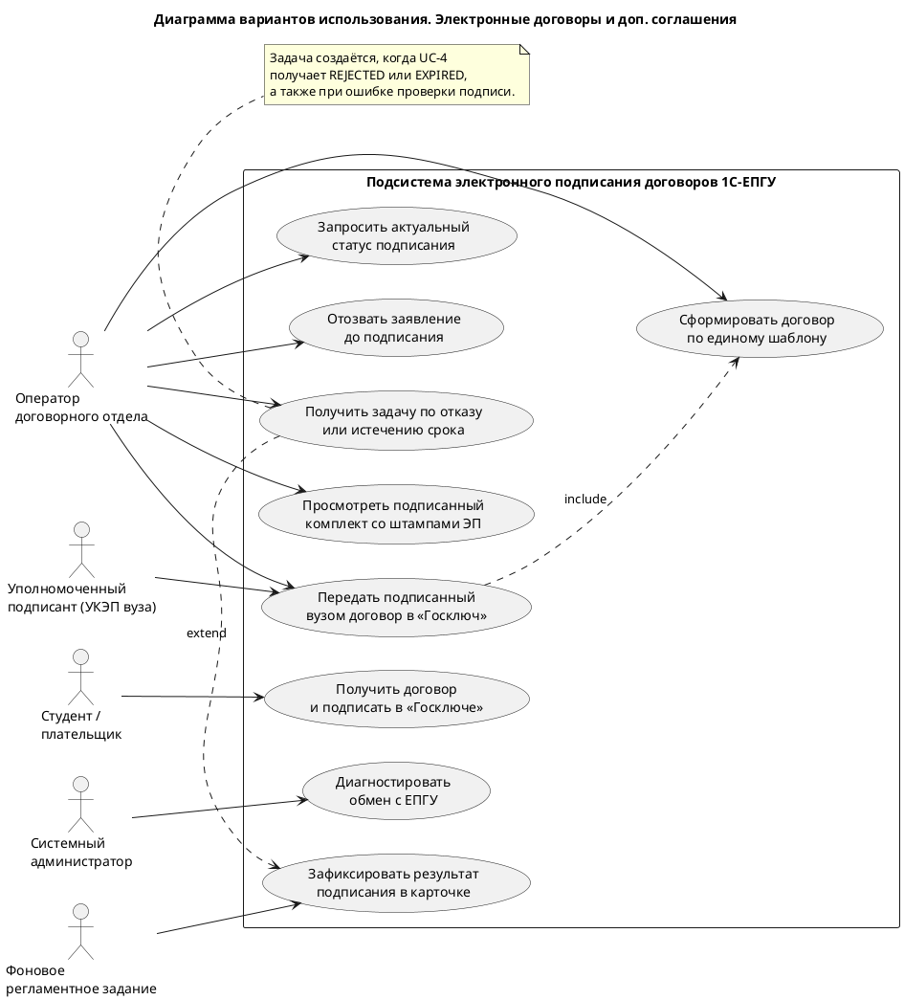

# Документ пользовательских требований

**Вариант:** 03-Электронные-договоры-и-допсоглашения  
**Команда:** Сапунков Артемий Романович, Блошкин Юрий Викторович (гр. ПрИн-366)  
**Связанный документ концепции:** [`case_concept.md`](case_concept.md) (лабораторная работа 1)  
**Дата:** 2026-11-20  
**Статус:** версия 1.0, прошла проверку по десяти шагам

Пользовательское требование в этой работе — эпик. Эпик описывает законченную цель актора, а не отдельное поле формы и не одну кнопку. У каждого эпика две записи об одном и том же требовании: пользовательская история и сценарий использования. История и сценарий проверены на согласованность: если история обещает одну ценность, сценарий заканчивается той же ценностью.

Все числовые метрики взяты из `case_concept.md` (разделы 2.3, 4, 5, 9) или из материалов ИТ-отдела в `src/1С-Университет-ПРОФ/`. Метрика, которой нет в концепции, помечена как допущение и связана с риском. Новых бизнес-целей в документ не добавлялось: используются только BO-1…BO-4 из концепции.

---

## 1. Реинжиниринг дерева функций

### 1.1. Исходное дерево функций

Исходное дерево взято из [`case_concept.md`](case_concept.md), раздел 4.2, без переписывания «как хотелось бы».

```mermaid
flowchart TB
  subgraph System["Подсистема электронного подписания 1С–ЕПГУ"]
    F1["1. Формирование документа"]
    F2["2. Подписание вузом"]
    F3["3. Интеграция с ЕПГУ"]
    F4["4. Фиксация результата"]
    F5["5. Администрирование и аудит"]
  end

  F1 --> F11["Генерация PDF/A из макета 1С"]
  F1 --> F12["Проверка обязательных реквизитов (СНИЛС, паспорт, сумма)"]
  F1 --> F13["Блокировка редактирования полей карточки"]

  F2 --> F21["Выбор криптопровайдера (КриптоПро CSP)"]
  F2 --> F22["Создание отсоединенной УКЭП вуза (.sig)"]
  F2 --> F23["Сохранение подписи в хранилище объекта 1С"]

  F3 --> F31["Формирование JSON-пакета запроса API ЕПГУ"]
  F3 --> F32["Отправка заявления (POST /v1/orders)"]
  F3 --> F33["Регламентный опрос статусов (GET /v1/orders/{orderId})"]
  F3 --> F34["Обработка ошибок транспорта и валидации API"]

  F4 --> F41["Загрузка подписи студента из Госключа"]
  F4 --> F42["Валидация целостности и цепочки сертификата"]
  F4 --> F43["Автоматический перевод договора в 'Утвержден'"]
  F4 --> F44["Формирование PDF со штампами визуализации ЭП"]

  F5 --> F51["Журналирование событий обмена (лог API)"]
  F5 --> F52["Оповещение оператора о сбоях и отказах"]
```

### 1.2. Сверка дерева с пользовательскими целями

| ID эпика | Пользовательское требование | Узел дерева функций | Есть в дереве | Что сделано |
|----------|-----------------------------|---------------------|---------------|-------------|
| EP-1 | Оператор формирует договор или доп. соглашение из карточки 1С по единому шаблону | 1. Формирование документа → F11 «Генерация PDF/A из макета 1С», F12 «Проверка обязательных реквизитов» | да | оставлен; F13 «Блокировка редактирования» отнесена к EP-2, потому что блокировка наступает после подписания и отправки, а не после предпросмотра |
| EP-2 | Оператор подписывает договор УКЭП вуза и отправляет студенту в «Госключ» | 2. Подписание вузом → F21–F23; 3. Интеграция с ЕПГУ → F31, F32, F34; F13 | да | оставлен; F33 «Регламентный опрос» вынесен в EP-4, потому что это отдельная автоматическая цель, а не шаг отправки |
| EP-3 | Студент или плательщик получает договор в «Госключе», знакомится и подписывает либо отказывается | 3. Интеграция с ЕПГУ → доставка и уведомление второй стороны | пробел | добавлен узел F35 «Доставка документа и уведомление второй стороны в Госключе»; без него цель студента в дереве не видна |
| EP-4 | Система автоматически забирает подпись студента и переводит договор в «Утвержден» | 4. Фиксация результата → F41–F43 | да | оставлен; сюда же отнесён F33 как источник статуса |
| EP-5 | Оператор просматривает и выгружает подписанный комплект со штампами ЭП | 4. Фиксация результата → F44 | да | оставлен |
| EP-6 | Оператор вручную запрашивает актуальный статус по договору | 3. Интеграция с ЕПГУ → ручной запрос статуса | пробел | добавлен узел F36 «Ручной запрос статуса по договору»; в исходном дереве был только регламентный опрос F33 |
| EP-7 | Оператор отзывает заявление до подписания студентом | 3. Интеграция с ЕПГУ → отзыв заявления | пробел | добавлен узел F37 «Отзыв (аннулирование) заявления»; функция FE-7 заявлена в концепции, но в дереве отсутствовала |
| EP-8 | Системный администратор диагностирует обмен и видит очередь ошибок | 5. Администрирование и аудит → F51, F52; просмотр очереди и повторная отправка | пробел | добавлен узел F53 «Просмотр очереди обмена и повторная отправка»; F51–F52 уже были |
| EP-9 | Оператор получает задачу по отказу студента или истечению срока | 4. Фиксация результата → обработка отказа и истечения срока; F52 | пробел | добавлен узел F45 «Обработка отказа студента и истечения срока»; F52 дополняет его оповещением |

### 1.3. Скорректированное дерево функций

```mermaid
flowchart TB
  subgraph System["Подсистема электронного подписания 1С–ЕПГУ"]
    F1["1. Формирование документа"]
    F2["2. Подписание вузом"]
    F3["3. Интеграция с ЕПГУ"]
    F4["4. Фиксация результата"]
    F5["5. Администрирование и аудит"]
  end

  F1 --> F11["Генерация PDF/A из макета 1С"]
  F1 --> F12["Проверка обязательных реквизитов (СНИЛС, паспорт, сумма)"]
  F1 --> F13["Блокировка редактирования полей карточки"]

  F2 --> F21["Выбор криптопровайдера (КриптоПро CSP)"]
  F2 --> F22["Создание отсоединенной УКЭП вуза (.sig)"]
  F2 --> F23["Сохранение подписи в хранилище объекта 1С"]

  F3 --> F31["Формирование JSON-пакета запроса API ЕПГУ"]
  F3 --> F32["Отправка заявления (POST /v1/orders)"]
  F3 --> F33["Регламентный опрос статусов (GET /v1/orders/{orderId})"]
  F3 --> F34["Обработка ошибок транспорта и валидации API"]
  F3 --> F35["Доставка документа и уведомление второй стороны в Госключе"]
  F3 --> F36["Ручной запрос статуса по договору"]
  F3 --> F37["Отзыв (аннулирование) заявления"]

  F4 --> F41["Загрузка подписи студента из Госключа"]
  F4 --> F42["Валидация целостности и цепочки сертификата"]
  F4 --> F43["Автоматический перевод договора в 'Утвержден'"]
  F4 --> F44["Формирование PDF со штампами визуализации ЭП"]
  F4 --> F45["Обработка отказа студента и истечения срока"]

  F5 --> F51["Журналирование событий обмена (лог API)"]
  F5 --> F52["Оповещение оператора о сбоях и отказах"]
  F5 --> F53["Просмотр очереди обмена и повторная отправка"]
```

### 1.4. Что не стало эпиком и почему

| Узел или цель | Почему не эпик |
|---------------|----------------|
| F13 «Блокировка редактирования полей карточки» | это бизнес-правило BR-2 и шаг сценария EP-2, а не отдельная цель актора |
| F21 «Выбор криптопровайдера» | техническая настройка администратора, не пользовательская цель договорного отдела |
| F42 «Валидация целостности и цепочки сертификата» | шаг EP-4; пользователь не принимает по нему отдельного решения |
| Трёхсторонние договоры с юридическими лицами через коммерческий ЭДО | вынесено за рамки выпуска 1.0, `case_concept.md`, раздел 6.2, п. 3; выпуск 2.0 |
| Онлайн-оплата первого транша при подписании | вынесено за рамки выпуска 1.0, `case_concept.md`, раздел 6.2, п. 4; выпуск 2.0 |
| Личный кабинет студента для подписи | вынесено за рамки, `case_concept.md`, раздел 6.2, п. 2; подпись остаётся в «Госключе» |
| Расчёт стоимости, учебные планы и графики платежей | существующий механизм 1С, не меняется; `case_concept.md`, раздел 6.2, п. 1 |
| Бумажное подписание как резервный канал | внешний резервный процесс, не функция подсистемы; упомянут в RSK-1 |

---

## 2. Диаграмма вариантов использования

Исходник: [`diagrams/usecase.puml`](diagrams/usecase.puml). В документ вставлен тот же код.

### 2.1. Граница системы

Граница названа по кейсу: **«Подсистема электронного подписания договоров 1С–ЕПГУ»**. Внутри границы — функции, которые выполняет расширение «1С:Университет ПРОФ»: формирование PDF/A, подписание УКЭП вуза, отправка заявления, опрос статусов, приём подписи, визуализация штампов, отзыв и журналирование. «Госключ» и ЕПГУ — внешние системы: студент подписывает документ там, а подсистема получает результат через API. Поэтому UC-3 показывает цель студента, но не внутренние экраны «Госключа».

### 2.2. Соответствие «узел дерева → вариант использования → актор»

| Узел дерева | Вариант использования | Актор |
|-------------|----------------------|-------|
| 1. Формирование документа → F11, F12 | UC-1 Сформировать договор по единому шаблону | Оператор договорного отдела |
| 2. Подписание вузом → F21–F23; 3. Интеграция → F31, F32, F34; F13 | UC-2 Передать подписанный вузом договор в «Госключ» | Оператор договорного отдела; уполномоченный подписант (владелец УКЭП) |
| 3. Интеграция с ЕПГУ → F35 | UC-3 Получить договор и подписать в «Госключе» | Студент / плательщик |
| 3. Интеграция → F33; 4. Фиксация → F41–F43 | UC-4 Зафиксировать результат подписания в карточке | Фоновое регламентное задание |
| 4. Фиксация результата → F44 | UC-5 Просмотреть подписанный комплект со штампами ЭП | Оператор договорного отдела |
| 3. Интеграция с ЕПГУ → F36 | UC-6 Запросить актуальный статус подписания | Оператор договорного отдела |
| 3. Интеграция с ЕПГУ → F37 | UC-7 Отозвать заявление до подписания | Оператор договорного отдела |
| 5. Администрирование и аудит → F51–F53 | UC-8 Диагностировать обмен с ЕПГУ | Системный администратор |
| 4. Фиксация → F45; 5. Администрирование → F52 | UC-9 Получить задачу по отказу или истечению срока | Оператор договорного отдела |

### 2.3. Почему на диаграмме именно такие связи

- **`include` UC-2 → UC-1.** В основном потоке UC-2 шаг 4 явно вызывает формирование PDF/A. Без PDF подписывать нечего. Это не «стрелка для красоты», а обязательное включение.
- **`extend` UC-9 → UC-4.** UC-4 в успешном исходе переводит договор в «Утвержден». Задача оператору появляется только в ветке `REJECTED` / `EXPIRED` или при ошибке проверки подписи, то есть это необязательное расширение базового сценария.
- **Нет `include` у UC-6 и UC-4.** Ручной и автоматический запрос статуса решают разные цели и запускаются по-разному. Общая у них только внутренняя операция `GET /v1/orders/{orderId}`, но она не является отдельным вариантом использования пользователя. Дублировать её стрелкой `include` значило бы рисовать связь, которой нет в сценарии.
- **Нет `extend` у UC-7 и UC-3.** Отзыв — не расширение подписания, а отдельная цель оператора с собственным триггером. Если студент уже подписал, отзыв недоступен; это исключение UC-7, а не расширение UC-3.
- **Акторы — роли из профилей заинтересованных лиц.** В `case_concept.md` раздел 3.1 перечислены договорной отдел, юридическая служба, уполномоченный подписант, студенты/плательщики и ИТ-служба. На диаграмме нет «пользователя» без роли. Фоновое задание — системный актор, потому что в концепции UC-9 прямо назван «регламентное фоновое задание 1С».
